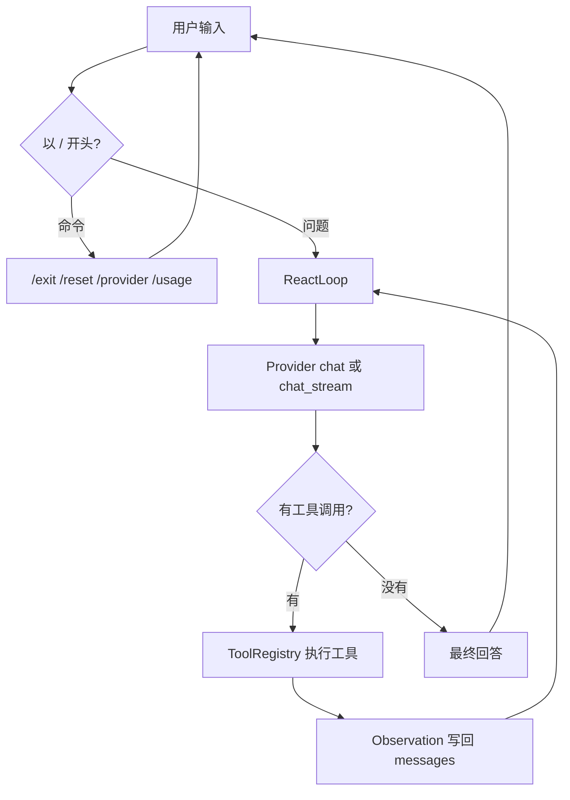

# mini-agent

一个命令行里的 ReAct 智能体。它把用户问题交给大模型，模型可以调用计算器和天气工具，把观察结果写回对话，直到给出最终回答。

## 功能

- 交互式 REPL：普通输入进入推理循环，以 `/` 开头的输入当作命令
- ReAct 循环：Thought → Action → Observation，直到模型不再调用工具
- 流式输出默认开启，可用 `--no-stream=true` 改为一次性返回
- 工具：`calculator`（安全地计算四则运算）、`get_weather`（查询城市天气）
- 模型：`deepseek`、`kimi`（OpenAI 兼容接口）。`anthropic`、`gemini` 已列入名称，原生适配尚未接上
- 故障切换：`FailoverProvider` 在连接失败、超时、限流或 429/500/502/503/504 时尝试下一个 provider
- Token 用量统计，REPL 里用 `/usage` 查看

REPL 命令：

| 命令 | 作用 |
| --- | --- |
| `/exit` | 退出。Ctrl+C 或输入结束同样退出 |
| `/reset` | 清空对话，只保留第一条 system 消息，并把迭代计数归零 |
| `/provider <name>` | 切换模型，例如 `/provider kimi` |
| `/usage` | 打印当前 provider 的 `usage_tracker.summary()` |

## 安装

需要 Python 3.14 和 [uv](https://docs.astral.sh/uv/)。

```powershell
uv sync
```

## 环境变量

在项目根目录创建 `.env`。下面只列出键名，不要把真实密钥写进仓库。`.gitignore` 已经忽略 `.env`。

每个 provider 使用同一组后缀，把 `<NAME>` 换成大写的 provider 名（如 `DEEPSEEK`、`KIMI`）：

- `<NAME>_API_KEY`
- `<NAME>_BASE_URL`
- `<NAME>_TIMEOUT`
- `<NAME>_MODEL_NAME`

另外：

- `AMAP_KEY`：高德天气接口密钥，`get_weather` 会读取它
- `DEFAULT_PROVIDER`：可选，未指定 provider 时的默认值，缺省为 `deepseek`

当前可实际调用的是 `DEEPSEEK_*` 和 `KIMI_*`。

## 运行

```powershell
uv run main.py --provider=deepseek --verbose=true --no-stream=false
```

常用参数：

| 参数 | 默认值 | 说明 |
| --- | --- | --- |
| `--provider` | `deepseek` | 使用的模型 |
| `--max-iter` | `3` | 单次问题最多推理轮数 |
| `--no-stream` | `false` | `true` 关闭流式输出，`false` 开启 |
| `--verbose` | `false` | 打印每轮消息、工具调用和用量 |
| `--failover` | 无 | 故障切换入口。代码里的 `FailoverProvider` 接受 provider 名称列表；命令行目前把整段字符串原样传入，不会按逗号拆开 |

布尔参数接受 `true` / `false`、`1` / `0`、`yes` / `no`，不区分大小写。

启动后按提示输入问题，例如「北京今天天气怎么样」或「(1 + 2) * 3」。

## 目录结构

```text
mini-agent/
├── main.py              # REPL 与 ReactLoop
├── providers.py         # 模型配置、调用、用量和故障切换
├── pyproject.toml
├── uv.lock
├── .python-version
├── .gitignore
├── .env                 # 本地密钥，不提交
├── README.md
└── tools/
    ├── tool.py          # 工具注册表
    ├── calculator.py    # 计算器
    └── get_weather.py   # 天气
```

## 架构

一次提问在 `ReactLoop` 里循环。模型返回工具调用时，注册表执行工具并把结果作为 observation 追加到 `messages`，然后进入下一轮。模型直接给出文本时，循环结束。


